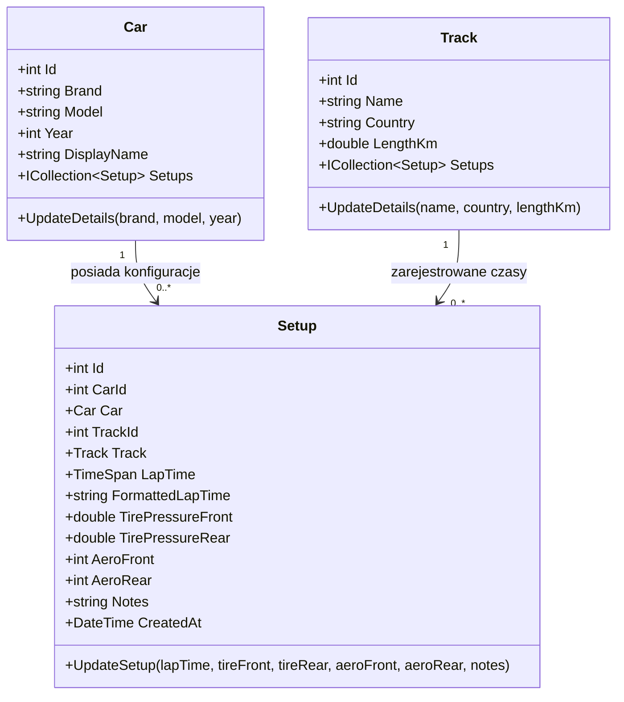

# SimSetup Tracker 🏁

**SimSetup Tracker** to webowa aplikacja w C# / .NET służąca do zarządzania konfiguracjami samochodów (setupami) w grach simracingowych (np. Assetto Corsa, ACC, iRacing) i śledzenia wpływu tych ustawień na czasy okrążeń na poszczególnych torach.

---

## 1. Informacje podstawowe
- **Nazwa projektu:** SimSetup Tracker
- **Skład drużyny:** Paweł Nawrocki
- **Krótki opis pomysłu:** Zewnętrzne narzędzie analityczne z własną bazą danych, pozwalające na kategoryzowanie, archiwizowanie i zestawianie ustawień aut, pomagające odpowiedzieć na pytanie, czy dane zmiany mechaniczne poprawiły tempo wyścigowe.

---

## 2. Cel projektu
- **Co chcieliśmy stworzyć?** Narzędzie analityczne pozwalające na śledzenie historii zmian w samochodzie wyścigowym.
- **Jaki problem / potrzebę projekt ma rozwiązywać?** Gracze często gubią się w tym, czy obniżenie ciśnienia w oponach lub zmiana kątów nachylenia kół ostatecznie poprawiła ich czas. Aplikacja rozwiązuje problem braku przejrzystego systemu do weryfikacji tych danych.
- **Dla kogo jest projekt?** Dla graczy simracingowych, inżynierów wyścigowych amatorów i pasjonatów symulatorów.
- **Co użytkownik będzie mógł dzięki niemu zrobić?** Dodać wybrany samochód i tor, wprowadzić kluczowe parametry telemetryczne/mechaniczne, przypisać uzyskany czas okrążenia, a następnie porównać wyniki dla różnych konfiguracji.

---

## 3. Plan i zakres projektu
- **Najważniejsze funkcje (MVP):** Formularze wprowadzania danych (modele: Auto, Tor, Setup, Czas), widok tabelaryczny historii przejazdów, proste filtrowanie po torze i samochodzie.
- **Co projekt musi posiadać:** Backend napisany w C# (.NET Web API), zastosowane zasady programowania obiektowego (OOP, enkapsulacja), relacyjną bazę danych z wykorzystaniem Entity Framework Core (SQLite) oraz interfejs graficzny w przeglądarce.
- **Funkcje dodatkowe / opcjonalne:** Integracja z telemetrią na żywo (skrypt Python nasłuchujący protokołu UDP z gry), przeniesienie i kompilacja interfejsu na urządzenia mobilne (Android/iOS) przy pomocy .NET MAUI, generowanie wykresów w czasie rzeczywistym.
- **Przewidywany efekt końcowy:** Uruchamialna, w pełni funkcjonalna aplikacja webowa z własnym API i wersjonowanym repozytorium na GitHubie.

---

## 4. Diagram Klas Domenowych (UML / Mermaid)



---

## 5. Struktura Rozwiązania

```text
SimSetupTracker/
├── SimSetupTracker.slnx             # Główna solucja Visual Studio
├── .gitignore                       # Ignorowanie plików tymczasowych, buildów i bazy SQLite
├── README.md                        # Dokumentacja projektu i sprintu
│
├── SimSetup.Shared/                 # Warstwa współdzielona (modele domenowe, reguły biznesowe)
│   ├── Models/
│   │   ├── Car.cs                   # Encja samochodu z enkapsulacją i walidacją
│   │   ├── Track.cs                 # Encja toru wyścigowego
│   │   └── Setup.cs                 # Encja konfiguracji setupu i czasu okrążenia
│   └── SimSetup.Shared.csproj
│
└── SimSetup.Api/                    # Warstwa ASP.NET Core Web API
    ├── Controllers/
    │   └── CarsController.cs        # Kontroler RESTful CRUD dla obiektów Car
    ├── Data/
    │   └── AppDbContext.cs          # Kontekst Entity Framework Core z relacjami i Seed Data
    ├── Migrations/                  # Wygenerowane migracje bazy danych EF Core
    │   └── 20260925064827_InitialCreate.cs
    ├── Properties/
    │   └── launchSettings.json
    ├── appsettings.json             # Konfiguracja SQLite ConnectionString
    ├── Program.cs                   # Rejestracja serwisów, EF Core, Swagger i potoku HTTP
    ├── SimSetup.Api.http            # Gotowe żądania HTTP do testowania API
    └── SimSetup.Api.csproj
```

---

## 6. Sprint Planning & Realizacja

### SPRINT GOAL
- **Główny cel sprintu:** Inicjalizacja projektu, utworzenie repozytorium oraz zaprojektowanie i wdrożenie podstawowych modeli obiektowych wraz z bazą danych.
- **Osiągnięty rezultat:** Działający szkielet backendu w .NET Web API z podłączoną bazą danych (Entity Framework Core SQLite), wykonaną migracją, seedem danych, kontrolerem CRUD `CarsController` oraz interfejsem Swagger UI.

### SPRINT BACKLOG

| # | Zadanie | Odpowiedzialny | Priorytet | Termin | Status |
|---|---|---|---|---|---|
| 1 | Założenie repozytorium i inicjalizacja solucji w Visual Studio | Paweł Nawrocki | 🔴 Must have | 19.09 | **Done** |
| 2 | Projekt diagramu klas dla obiektów domenowych (Car, Track, Setup) | Paweł Nawrocki | 🔴 Must have | 20.09 | **Done** |
| 3 | Implementacja modeli w C# z użyciem zasad enkapsulacji | Paweł Nawrocki | 🔴 Must have | 24.09 | **Done** |
| 4 | Konfiguracja Entity Framework Core i połączenia z bazą SQLite | Paweł Nawrocki | 🔴 Must have | 27.09 | **Done** |
| 5 | Wykonanie pierwszej migracji bazy danych (`InitialCreate` & `Update-Database`) | Paweł Nawrocki | 🟡 Should have | 29.09 | **Done** |
| 6 | Stworzenie bazowych kontrolerów API (CRUD) dla obiektów "Car" | Paweł Nawrocki | 🟡 Should have | 02.10 | **Done** |
| 7 | Utworzenie testowej dokumentacji żądań HTTP (Swagger UI + plik `.http`) | Paweł Nawrocki | 🟢 Could have | 02.10 | **Done** |

---

## 7. Instrukcja Uruchomienia i Testowania

### Budowanie solucji:
```bash
dotnet build
```

### Aktualizacja bazy danych (SQLite):
```bash
dotnet ef database update --project SimSetup.Api
```

### Uruchomienie Web API:
```bash
dotnet run --project SimSetup.Api --launch-profile http
```

### Testowanie API:
- **Swagger UI:** Otwórz w przeglądarce [http://localhost:5021](http://localhost:5021)
- **Plik żądań HTTP:** Otwórz `SimSetup.Api/SimSetup.Api.http` w Visual Studio lub VS Code i kliknij *Send Request*.
